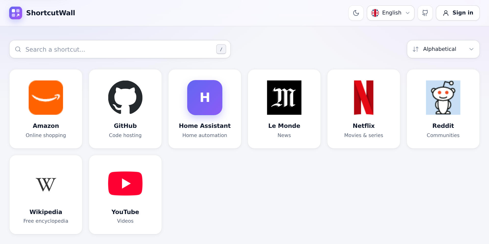
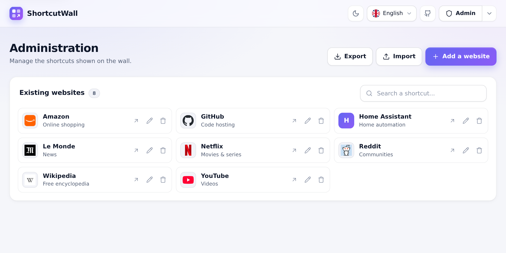
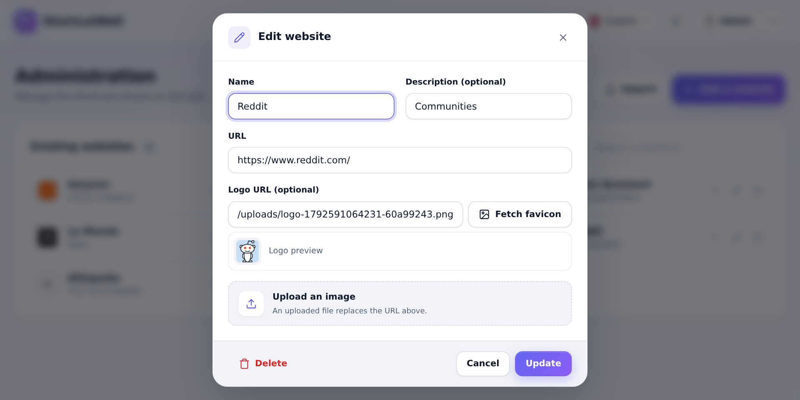
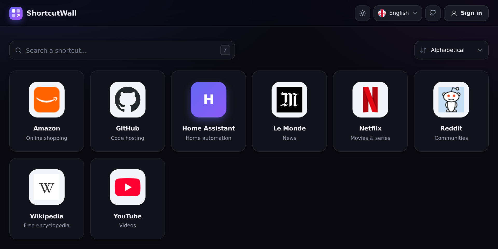
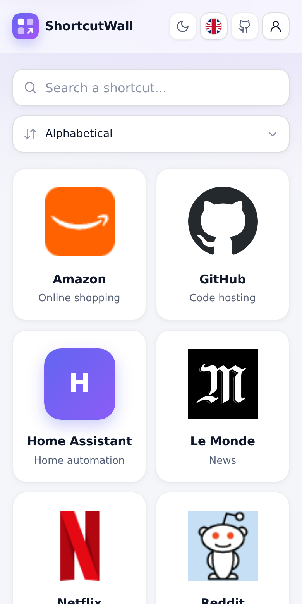

<div align="center">


# ShortcutWall

**Votre mur de raccourcis web, auto-hébergé.**<br />
Une page avec tous les sites utiles et leur logo, et une administration simple pour les gérer.

[](https://github.com/MrDDream/ShortcutWall/actions/workflows/ci.yml)
[](https://github.com/MrDDream/ShortcutWall/releases)
[](https://github.com/MrDDream/ShortcutWall/pkgs/container/shortcutwall)
[](LICENSE)

[Site web](https://mrddream.github.io/ShortcutWall/) · [English](README.md) · Français



</div>

## ✨ Fonctionnalités

- 🧱 **Mur de raccourcis** : de grandes cartes avec logo, nom et description ; un clic ouvre le site.
- 🔎 **Recherche et tri instantanés** : touche <kbd>/</kbd> pour chercher dans les noms, descriptions et domaines ; ordre alphabétique ou du plus récent.
- 🖼️ **Logos automatiques** : « Récupérer le favicon » trouve la meilleure icône du site, la stocke dans l'app et la réduit à 256 px : le mur reste rapide et n'affiche jamais d'image cassée.
- 🛠️ **Administration en pop-ups** : ajout, modification et suppression sans quitter la liste ; une suppression s'annule pendant 15 secondes.
- 💾 **Export / import** : un fichier JSON avec tous les raccourcis et leurs logos, pour sauvegarder ou déménager une installation.
- 🌗 **Thèmes clair et sombre**, 🌐 **français et anglais**, 📱 **adapté au mobile**.
- 🏠 **Sites internes aussi** : raccourcis vers votre box, NAS ou Proxmox du réseau local, certificats auto-signés compris.
- 🔒 **Sécurisé par défaut** : protection CSRF, CSP stricte, limitation des tentatives de connexion, garde-fou SSRF, refus de démarrer avec les identifiants par défaut.

## 🚀 Installation

ShortcutWall est fourni sous forme d'image Docker prête à l'emploi (`linux/amd64` et `linux/arm64`, par
exemple un Raspberry Pi) : **`ghcr.io/mrddream/shortcutwall`**. Il suffit de Docker avec Compose.

### 1. Créez un dossier avec ce `docker-compose.yml`

```bash
mkdir shortcutwall && cd shortcutwall
```

```yaml
services:
  shortcutwall:
    image: ghcr.io/mrddream/shortcutwall:latest
    container_name: ShortcutWall
    ports:
      - "${PORT:-3050}:${PORT:-3050}"
    # ADMIN_USER, ADMIN_PASS, SESSION_SECRET… come from .env (see .env.example):
    # the app refuses to start in production without real values.
    env_file:
      - path: .env
        required: false
    environment:
      NODE_ENV: production
      PORT: ${PORT:-3050}
      HOST: ${HOST:-0.0.0.0}
    volumes:
      - ./data:/app/data
      - ./public/uploads:/app/public/uploads
    restart: unless-stopped
```

### 2. Créez les dossiers de données et le fichier `.env`

Le conteneur tourne avec un utilisateur non privilégié (uid 1000) : créez les dossiers vous-même, sinon
Docker les crée en `root` et l'application ne peut pas y écrire.

```bash
mkdir -p data public/uploads
```

```bash
printf 'ADMIN_USER=admin\nADMIN_PASS=%s\nSESSION_SECRET=%s\n' 'choisissez-un-mot-de-passe-solide' "$(openssl rand -hex 32)" > .env
```

Remplacez `choisissez-un-mot-de-passe-solide` par votre mot de passe. Les autres réglages sont facultatifs
(voir [Configuration](#%EF%B8%8F-configuration)).

### 3. Lancez

```bash
docker compose up -d
```

Le mur est accessible sur **http://localhost:3050** et l'administration sur **http://localhost:3050/admin**.

### Mettre à jour

```bash
docker compose pull && docker compose up -d
```

Pour rester sur une version précise, remplacez `latest` par un numéro de version, par exemple
`ghcr.io/mrddream/shortcutwall:1.2.0`. Les versions disponibles sont listées sur la
[page des releases](https://github.com/MrDDream/ShortcutWall/releases).

## 📸 Captures d'écran

| Administration | Modification d'un site |
|:---:|:---:|
|  |  |
| **Thème sombre** | **Sur téléphone** |
|  |  |

## ⚙️ Configuration

Tous les réglages se font dans le fichier `.env` à côté de `docker-compose.yml`, puis
`docker compose up -d` pour les appliquer.

| Variable | Défaut | Description |
|----------|--------|-------------|
| `ADMIN_USER` | `admin` | Identifiant d'administration. |
| `ADMIN_PASS` | — | Mot de passe d'administration. **Obligatoire** : l'app refuse de démarrer avec celui par défaut. |
| `SESSION_SECRET` | — | Secret aléatoire d'au moins 32 caractères (`openssl rand -hex 32`). **Obligatoire.** |
| `PORT` | `3050` | Port de l'application (et port publié). |
| `TRUST_PROXY` | `false` | À mettre à `true` derrière un reverse proxy (HTTPS, vraie IP du client pour la limite de connexion). |
| `ALLOW_PRIVATE_NETWORKS` | `true` | Permet d'ajouter des sites hébergés sur votre réseau local ou VPN (`192.168.x.x`, `10.x.x.x`, `nas.lan`…). À mettre à `false` si des personnes de confiance limitée accèdent à l'administration. |
| `APP_NAME` | `ShortcutWall` | Nom affiché dans l'en-tête et le titre des pages. |
| `APP_DEFAULT_LOCALE` | `fr` | Langue par défaut : `fr` ou `en`. |
| `SUPPORT_EMAIL` / `SUPPORT_PHONE` | — | Contacts affichés dans une fenêtre « Besoin d'aide ? » (masquée si vides). |
| `LOG_LEVEL` | `info` | `fatal`, `error`, `warn`, `info`, `debug` ou `trace`. |

## 🧭 Utilisation

- **Mur** (`/`) : public, sans compte. Un clic sur une carte ouvre le site.
- **Administration** (`/admin`) : *Ajouter un site*, puis *Récupérer le favicon* pour obtenir son logo
  automatiquement ; un clic sur une tuile permet de la modifier.
- **Sites internes** : saisissez l'adresse par laquelle la machine Docker les joint (`http://192.168.1.10:8080`,
  `https://nas.lan`) ; les certificats auto-signés sont acceptés sur le réseau local.
- **Sauvegarde** : *Exporter* télécharge `shortcutwall-AAAA-MM-JJ.json` (logos inclus) ; *Importer* le
  restaure, en le fusionnant avec les sites actuels ou en les remplaçant (annulable pendant 15 secondes).
- **Données** : les raccourcis sont dans `./data`, les logos dans `./public/uploads`. Sauvegardez ces deux
  dossiers, ou utilisez *Exporter*.

## 🔒 Sécurité

- Mot de passe d'administration et secret de session obligatoires en production ; une session n'est créée
  qu'à la connexion.
- Jetons CSRF sur tous les formulaires, Content-Security-Policy stricte, cookies `HttpOnly` / `SameSite`.
- Connexion limitée à 10 échecs par IP toutes les 15 minutes.
- Les requêtes sortantes (favicons, logos) ne peuvent jamais atteindre la machine de l'application ni les
  services de métadonnées cloud, même via une redirection (garde-fou SSRF). Les réseaux locaux sont autorisés
  pour pouvoir ajouter des sites internes ; `ALLOW_PRIVATE_NETWORKS=false` les bloque aussi. Les certificats
  des sites publics sont toujours vérifiés.
- Les fichiers téléversés sont vérifiés comme étant de vraies images et stockés sous des noms générés.
- L'image tourne avec un utilisateur non root, le code de l'application en lecture seule.

## 🩺 Dépannage

- **Le conteneur s'arrête avec `EACCES: permission denied`** : le dossier `data` ou `public/uploads`
  appartient à `root`. Corrigez avec `sudo chown -R 1000:1000 data public/uploads`, puis `docker compose up -d`.
- **Il refuse de démarrer (« Refusing to start in production… »)** : `ADMIN_PASS` ou `SESSION_SECRET`
  manque, garde sa valeur par défaut, ou le secret fait moins de 32 caractères. Vérifiez le fichier `.env`.
- **« Le site est inaccessible » pour un site interne** : la vérification part du conteneur, le site doit donc
  être joignable depuis la machine Docker. `localhost` désigne le conteneur lui-même : utilisez l'adresse
  réseau de la machine (par exemple `http://192.168.1.10:8080`).
- **Logs** : `docker compose logs -f`.

## 🛠️ Contribuer

Les issues et pull requests sont les bienvenues. Pour construire l'image depuis les sources, utilisez
`docker-compose-dev.yml` :

```bash
docker compose -f docker-compose-dev.yml up -d --build
```

Avant d'ouvrir une pull request, lancez les vérifications de la CI (Node.js 26) :

```bash
npm ci && npm run lint && npm run format:check && npm test
```

## 📄 Licence

[MIT](LICENSE) © [MrDDream](https://github.com/MrDDream)
